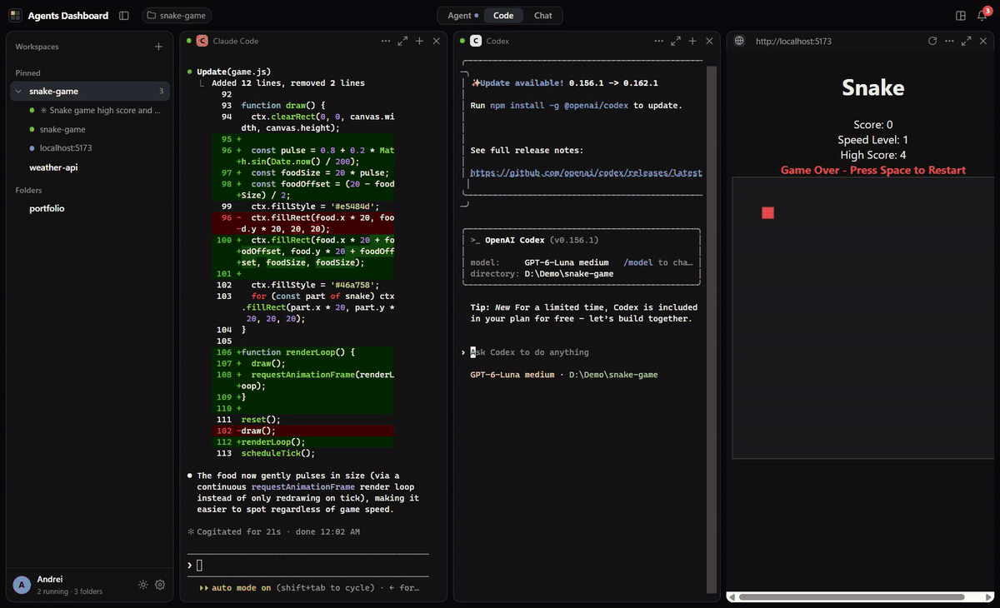
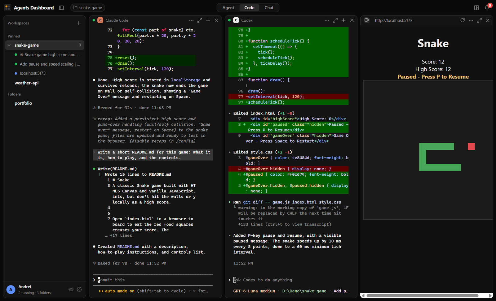
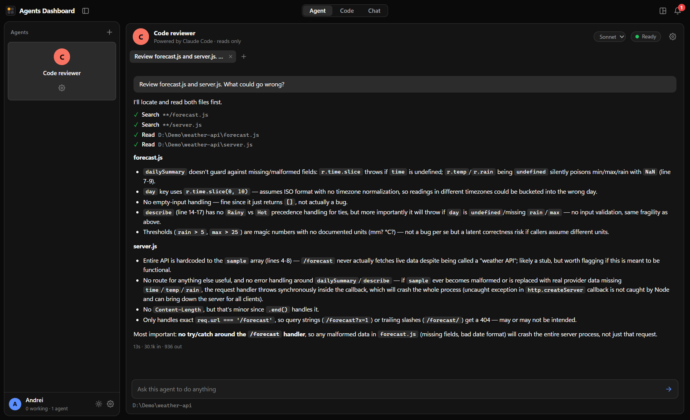
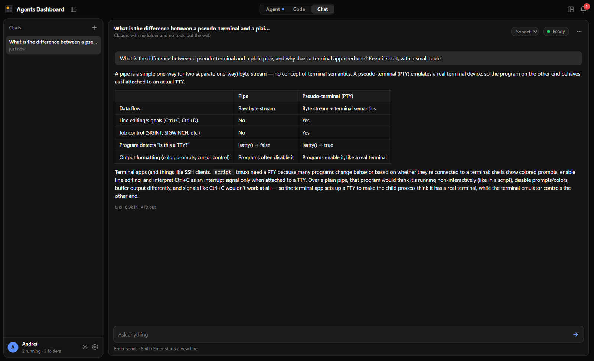
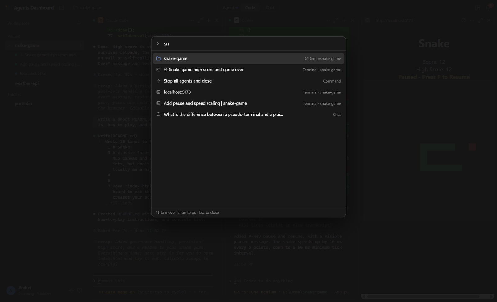
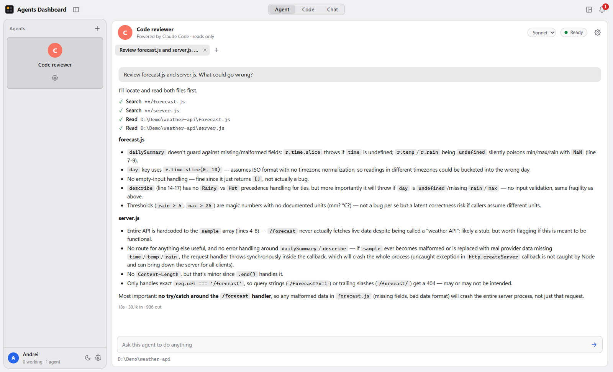
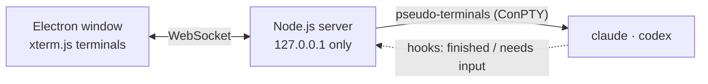

<p align="center">
  
</p>

<h1 align="center">Agents Dashboard</h1>

<p align="center">
  Run Claude Code and Codex side by side — every agent in its own real terminal,<br>
  one window that tells you which of them needs you.
</p>

<p align="center">
  <a href="https://github.com/andrei-cicortas/agents-dashboard/releases/latest"></a>
  <a href="https://github.com/andrei-cicortas/agents-dashboard/actions/workflows/test.yml"></a>
  
  <a href="LICENSE"></a>
</p>

<p align="center">
  
</p>

<p align="center"><sub>Claude Code and Codex each take a task on the same Snake game, at the same time. The game runs in the pane on the right. (Sped up 2×.)</sub></p>

## Why I built it

AI coding agents are good enough now that the slow part is no longer the
code — it is me. I would start Claude Code on one task, Codex on another, a
second Claude in another project, each in its own terminal window, and then
lose track: which one finished ten minutes ago, which one is stuck waiting for
me to approve something, which window was which.

So I built the place I wanted to work in: every agent in one window, tiled
like an editor, each in a real terminal so nothing about the agents changes —
and a bell that tells me the moment one of them finishes or needs an answer,
even when the window is closed.

## What it does



- **Real terminals, side by side.** Each agent runs exactly as it would in
  Windows Terminal. Split, resize and maximise panels; each project folder
  keeps its own arrangement.
- **Knows when an agent needs you.** A panel turns orange when its agent asks
  for input and the bell rings when one finishes — with a Windows notification
  and a red count on the taskbar when you are looking elsewhere. Clicking the
  notification opens that exact agent.
- **Keeps working when you close it.** Agents carry on in the background, and
  their conversations are picked up again after a restart.
- **Your app next to your agents.** Dock a web page — usually your dev server
  — beside the terminals and watch the agents' work appear.
- **Ctrl+K finds anything:** a folder, a terminal, an agent or a chat, by a
  few letters of its name.

<table>
  <tr>
    <td width="50%"></td>
    <td width="50%"></td>
  </tr>
  <tr>
    <td><b>Named agents.</b> Give one a folder and standing instructions, then
    talk to it in threads. It can only read files unless you allow more. Every
    tool it uses is shown, with what the turn cost.</td>
    <td><b>A chat on the side.</b> For the questions that come up while the
    agents work, with web search, and answers rendered as proper Markdown.</td>
  </tr>
  <tr>
    <td width="50%"></td>
    <td width="50%"></td>
  </tr>
  <tr>
    <td><b>Ctrl+K</b> to jump anywhere, and keyboard shortcuts that never take
    a key away from the agents.</td>
    <td><b>Dark and Light</b>, terminals and title bar included.</td>
  </tr>
</table>

It uses the Claude Code and Codex you already have, signed in the way you
already are — no API keys and no second subscription.

## Install

1. Install [Claude Code](https://docs.claude.com/claude-code) and sign in by
   running `claude` once in a terminal. Codex is optional:
   `npm install -g @openai/codex`, then `codex login`.
2. Download **`Agents-Dashboard-Setup-<version>.exe`** from the
   [latest release](https://github.com/andrei-cicortas/agents-dashboard/releases/latest)
   and run it. It installs for your user only, without administrator rights.

The installer is not code-signed yet, so Windows SmartScreen may say *"Windows
protected your PC"*: click **More info → Run anyway**. On a PC with Smart App
Control turned on, Windows will not run unsigned apps at all — you can
[build it from source](docs/development.md) instead.

After that the app keeps itself up to date: a new version downloads in the
background and installs the next time you quit.

**Getting started:** click **+** next to *Workspaces* and pick a project
folder, then **+** on the folder to start Claude Code or Codex in it. The
[user guide](docs/user-guide.md) covers everything else.

## How it works



A small Node.js server, running inside the Electron app, starts each agent in a
real pseudo-terminal and streams it to [xterm.js](https://xtermjs.org/) in the
window. Claude Code's hooks and Codex's `notify` call back into the app when a
turn ends or an agent needs an answer — that is how it knows which panel to
turn orange. Some of the problems worth solving along the way:

- **Finding a conversation again.** Claude Code accepts a session id; Codex
  picks its own, so the app reads it back from the file Codex writes. That
  keeps two Codex agents in one folder from resuming the same conversation.
- **Locking the local server down.** It listens on `127.0.0.1` only, checks
  `Host` and `Origin` against DNS rebinding and other websites, and accepts
  agent callbacks only with a secret token made fresh on every start.
- **Agents that cannot overreach.** A named agent gets read-only tools by
  default. The limit is enforced by giving the CLI only those tools, not by
  forbidding others by name — told it could not use Bash, an agent found
  another tool that runs commands.
- **Tiling as pure functions.** The layout is a tree of rows and columns;
  split, close and resize each return a new tree, kept in sync between windows.

More in [docs/architecture.md](docs/architecture.md).

## Built with

Electron · Node.js · [xterm.js](https://xtermjs.org/) ·
[node-pty](https://github.com/microsoft/node-pty) · plain ES modules with no
framework and no build step · 420 tests on Node's built-in test runner ·
electron-builder and GitHub Actions for releases.

I built it together with Claude Code, which wrote much of the code while I
directed the design, tested it daily and decided what stayed.

## Development

```powershell
git clone https://github.com/andrei-cicortas/agents-dashboard.git
cd agents-dashboard
npm install
npm start      # run the app from source
npm test
```

[docs/development.md](docs/development.md) covers building the installer,
releasing a version, and trying the UI with fake agents.

## Privacy

Everything stays on your computer. The app sends nothing anywhere; the agents
talk to their own services as they always do, and the only other request is
the update check against this repository's releases.

## Licence

[MIT](LICENSE) © Andrei Cicortas
