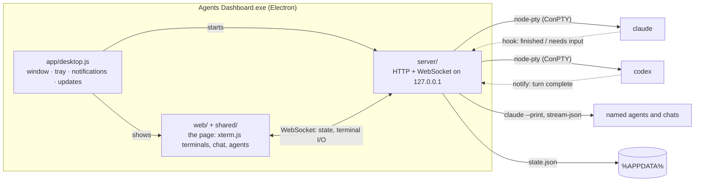

# Architecture

How Agents Dashboard is put together, and why it is put together that way.

## The pieces

**`app/`: the desktop app.** An Electron main process that starts the server
inside itself and shows it in one window. Closing the window only hides it, so
the agents keep working; the app waits in the notification area until it is
quit. It owns everything the page cannot do: Windows notifications, the
taskbar badge and flash, the remembered window position, single-instance
behaviour and self-updates from GitHub Releases. The page reaches it through a
small preload bridge (`app/preload.cjs`) that carries only a handful of named
messages.

**`server/`: the dashboard.** A plain Node.js HTTP and WebSocket server, which
also runs on its own (`npm run server`) and in a browser. It:

- starts every coding agent in a real pseudo-terminal (`@lydell/node-pty`,
  ConPTY on Windows), so Claude Code and Codex run exactly as they do in
  Windows Terminal: colours, cursor movement, their own prompts;
- keeps the last 256 KB of each terminal (`scrollback.js`), so a window that
  reconnects shows what happened while it was closed;
- holds all state — folders, panels, layouts, notifications, named agents,
  chats — and writes it atomically to `state.json` (`store.js`), retrying when
  antivirus or the search indexer briefly locks the file;
- broadcasts the whole state to every connected window, so two windows never
  disagree.

**`web/` and `shared/`: the page.** Plain ES modules with no build step and no
framework. `shared/` is the logic with no DOM in it — tiling, the palette's
fuzzy search, Markdown rendering, themes, status rules — so the same code runs
in the page and in the tests.

## Knowing when an agent needs you

A terminal cannot say "I'm done". The dashboard asks the agents to tell it:

- **Claude Code** gets a settings file with `Stop` and `Notification` hooks;
- **Codex** gets a `notify` program.

Both run `server/hook-client.js`, which posts the event to the server with a
per-run secret token and the panel's id, and always exits 0 so it can never
break an agent. In the installed app there is no separate `node.exe`, so the
hook is the app itself started with `--hook`; it sends the event and exits in
about 0.1 s.

An event is turned into a status (green: working, orange: needs your input,
grey: stopped) and, unless that panel is the one you are looking at, a
notification on the bell and in Windows.

## Panels that tile

Each folder's panels form a tree of rows and columns with a size for each
child (`shared/tiling.js`). Every operation — split, close, resize, tidy — is
a pure function from one tree to another, which keeps them easy to test.
Layouts are saved per folder and synchronised between windows; a change made
in one window is never undone by an older copy arriving from another
(`shared/layout-sync.js`).

## Named agents and chats

The Agent and Chat tabs do not use a terminal. Each message runs the Claude
Code CLI in print mode with `--output-format stream-json`, and the page draws
the stream of events as a transcript: what was asked, each tool used (with a
tick when it worked) and the answer, rendered from Markdown.

Using the CLI the user already has means no API key and no second
subscription. Threads are the CLI's own sessions, continued with `--resume`.

## Security

The server listens on `127.0.0.1` only, and treats every request as hostile
until proven otherwise:

- **Host header check**: stops DNS-rebinding, where a website points a domain
  at 127.0.0.1 to reach local servers.
- **Origin check on the WebSocket**: stops any other website open in a browser
  from connecting to it.
- **Secret token for hooks**: generated fresh on every start, compared in
  constant time, and only ever handed to the agents' own processes.
- **Named agents are read-only by default**: Read, Glob, Grep, WebSearch and
  WebFetch. Giving one Edit, Write and Bash is an explicit choice, asked for
  first. The limit is enforced by handing the CLI only the tools that exist
  for that run, not by forbidding tools by name — told it could not use Bash,
  an agent found another tool that also runs commands.
- **The window is sandboxed**: context isolation, no Node.js in the page, and
  only the dashboard itself (not a web page shown in a pane) can talk to the
  window. Links open in the default browser; nothing else can navigate the
  window away.

Nothing is sent anywhere except by the agents themselves, to their own
services, and the update check, which reads this repository's releases.

## Why Electron

The first version used only parts Windows already trusts — PowerShell, .NET
and WebView2 — because Smart App Control blocked anything unsigned on the
machine it was built on. It worked, but it could not be installed by anyone
else without cloning the repository and installing Node.js. Electron gives a
normal installer, automatic updates and a tray icon, and the server code did
not have to change: the Electron app simply runs it inside itself.

## How a panel finds its conversation again

Closing the window does not end a conversation, so a panel has to know which
one to pick up. The two agents go about that differently.

Claude Code is told which session to use, so the dashboard names one and asks
for it again later. Codex names its own and offers no way to choose it, so the
dashboard reads the id back out of the rollout file Codex writes, and resumes
that. Using `codex resume --last` instead would give every panel on a folder
the same conversation, which is wrong the moment two agents work side by side.

Either way the id is only written down once the conversation is real — a panel
you opened and never typed into has nothing to resume, so it simply starts.
Before Codex is asked to resume a conversation, the dashboard checks that
Codex still has it; and if a resume fails anyway, the panel starts fresh
instead of staying dead.

## Adding another agent type

The built-in agents are in `config/agents.json`. Users add their own in
`%APPDATA%\agents-dashboard\custom-agents.json` (see the
[user guide](user-guide.md#adding-other-agents)), which an update of the app
never touches; an entry there with the id of a built-in agent replaces it.
Each entry has:

- `command`: the program to run (must be on PATH)
- `startArgs` / `resumeArgs`: arguments for a new session / for continuing one
- placeholders: `{sessionId}`, `{claudeHooksFile}`, `{codexNotify}`
- `installHint`: shown when the command is not installed
- `sessionSource`: `"codex"` for an agent that names its own session, so its id
  is read back after it starts rather than chosen in advance

A file that cannot be read is reported in `server-error.log` and skipped, so a
typo in it never stops the app from opening.
