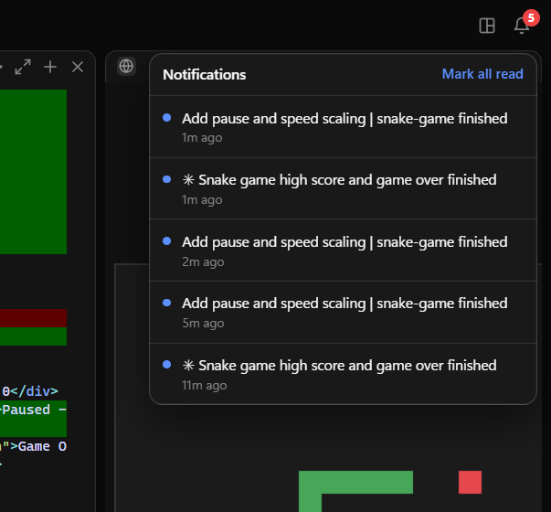

# User guide

Everything the app does, and where to find it. For installing it, see the [README](../README.md).

## The window

- There is one window. Opening the app again brings it to the front.
- **Closing the window does not stop the agents.** The app stays by the clock
  with them still working; click its icon to bring the window back. The first
  time, a notification says so.
- Right-click that icon for **Quit**, which stops every agent (it asks first),
  and **Start with Windows**, which opens the app in the background when you
  sign in.
- It remembers its size, position, zoom and whether it was maximised.
- The title bar follows Dark and Light.
- When something new rings the bell while the window is hidden, minimised or
  behind others, its taskbar button flashes and Windows shows a notification.
  Clicking the notification opens the terminal, thread or chat it is about.
  They can be turned off like any app's, in Windows Settings → System →
  Notifications.
- The unread count shows as a red badge on the taskbar button.
- Questions such as "Stop this agent?" come up in the app's own dialogs, which
  Escape cancels and Enter confirms.
- Links open in your own browser. Ctrl+F, Ctrl+N and the other shortcuts belong
  to the app, not to a browser.
- **Stop all agents and close** quits the app.

## Daily use

1. Open **Agents Dashboard** from the desktop, Start or the taskbar.
2. Click **+** next to "Workspaces". Walk down to the folder — it starts at the
   drives — or paste its path and press Enter, then **Add this folder**.
3. Hover the project, click **+**, and pick Claude Code or Codex.
4. Type your task into the panel's terminal.
5. The bell shows when an agent finishes or needs your input.

Anything that answers while you are looking somewhere else rings the bell — a
terminal on the Code tab, one of a named agent's threads, a chat. The tab it
came from gets a dot, and clicking the notification opens the very thing it is
about. Whatever is in front of you as it finishes never rings: you saw it.

The sidebar lists pinned folders first, then every other folder under
**Folders**. The canvas shows one workspace at a time: click a folder to open
it, or the chevron to fold its list of agents. Agents in other folders keep
running. The number beside a folder turns orange when an agent inside it is
waiting for you and grey when one has stopped, so a folded folder still says
what is going on in it. The card at the bottom shows who is signed in to the PC, how much is
running, and the two settings that belong to the window.

## Arranging the panels

Panels tile the canvas, so there is always exactly enough room for all of them.

- Drag the line between two panels to give one of them more space.
- **Open in Explorer**, in a folder's or a panel's **...** menu, shows the
  folder an agent is working in — only ever a folder already on screen.
- **Split right** and **Split down** in a panel's **...** menu start another
  agent of the same kind beside it.
- The grid button in the top bar has **Tidy**, which squares everything up
  again, and fixed column counts.
- The arrows in a panel header make it fill the canvas, and put it back.

Each workspace keeps its own arrangement, and it is still there when you
reopen the window.

## Finding something in a panel

An agent writes far more than fits on a screen. **Ctrl+F** inside a panel, or
**Find in output…** in its **...** menu, searches everything it has written:
every match is highlighted, the one you are on in yellow, and Enter and
Shift+Enter walk forwards and back. Escape closes it.

## Ctrl+K

One box that finds anything in the app: a folder, a terminal, a named agent, a
chat — and the handful of things worth starting. Type a few letters of the
name, in order but not necessarily next to each other (`sptg` finds "Spider
Tag"), and Enter goes there, switching tabs on the way if it has to. A folder's
name also finds everything working in that folder.

## Keyboard

| | |
|---|---|
| `Ctrl+K` | Go to anything |
| `Ctrl+1` `Ctrl+2` `Ctrl+3` | Agent, Code, Chat — even from inside a terminal |
| `Ctrl+B` | Show or hide the sidebar |
| `Ctrl+N` | New chat, or a new thread for the agent you are on |
| `Ctrl+F` | Find in the panel you are in |
| `Ctrl+C` | In a terminal with text selected: copy it. With nothing selected it goes to the agent, as always |
| `Ctrl+V` | In a terminal: paste, as in Windows Terminal (`Ctrl+Shift+V` too). Dictation apps such as Wispr Flow put their text in this way |
| `Ctrl`+click | Open an address shown in a terminal, in your browser |

The terminals get every other key, so nothing here is taken away from an agent.

## Web panes

**New web page** in a folder's **+** menu docks a browser beside the terminals,
so you can look at what the agents just built without leaving the window. It
starts on `http://localhost:3000`; type another address in its header and press
Enter. Only `http` and `https` addresses are accepted.

A web pane is an ordinary pane: it splits, resizes, maximises and is saved with
the rest of the arrangement. It runs no agent, so it never rings the bell and
is not counted among the running agents.

Some sites refuse to be shown inside another page (they send
`X-Frame-Options` or a `frame-ancestors` policy) and will come up blank. Local
dev servers normally do not.

## Agent mode

The **Agent** tab is the other half of the app. Where the Code tab gives you a
terminal to sit at, an agent answers on its own: you name it, give it a folder
and standing instructions, and then hold conversations with it.

- **+** next to Agents names one. Its folder is any folder on the disk —
  **Browse…** walks there, or paste the path — so an agent needs no workspace
  on the Code tab first. The instructions are appended to its system prompt, so
  they apply to everything it is ever asked.
- The pill by its name picks the model, the same three the Chat tab offers, and
  it can be changed later.
- Each agent keeps **threads** — separate conversations, shown as tabs. A
  thread remembers its session, so a later message continues where it left off.
- The transcript shows a line per thing: what you asked, what it did (each tool
  with a tick when it worked), and what it said back.

It runs the Claude Code CLI you already have, so it signs in the way the rest
of the app does — no API key and no second subscription — and each message
costs what a Claude Code message costs.

### What an agent is allowed to touch

A new agent can only **read**: Read, Glob, Grep, WebSearch and WebFetch. It
cannot run commands or change files. Nobody is sitting there to approve
anything, so that is the only safe default.

The gear next to its name has **Let it change files**, which asks first and
then adds Edit, Write and Bash. Give that to an agent whose folder you would
be happy to see rewritten.

The list is enforced by handing the CLI the set of tools that exist for that
run, not by forbidding tools by name: told it could not use Bash, an agent
found another tool that also runs commands and used that instead.

Agents also run with the CLI's `--safe-mode`, so your own CLAUDE.md, skills,
hooks and MCP servers are left out. An agent should behave the way its own
instructions say, not the way your machine happens to be set up.

## Chat

The **Chat** tab is for the questions that come up while the agents work —
what a flag does, how to word a commit message, whether an approach is
sensible — so answering one does not mean leaving the window.

It has no folder. It cannot read a file and cannot run a command; the only
tools it has are web search and fetching a page, because half of what anyone
asks depends on something newer than the model. There is nothing to set up:
type the question and the chat is created on it, named after what you asked.

- **+** next to Chats, or **New chat** in the **...** menu, clears the screen
  for a new one. Nothing is created until you ask something, so the list never
  fills with empty chats.
- The pill beside the title picks the model: **Sonnet** for everyday questions,
  **Opus** when it needs thinking about, **Haiku** when the answer is small.
  Changing it carries on the same conversation.
- Enter sends, Shift+Enter starts a new line, and **Stop** abandons an answer.

Answers are shown as they were written — headings, lists, tables and code
blocks. Hovering an answer gives a **Copy** that takes the whole thing as the
Markdown it was written in, and every code block has one of its own. Only
`http`, `https` and `mailto` addresses are ever clickable, and a link opens in
your own browser.

Under each answer is a line saying what the turn took — how long, and how many
tokens went in and came back. Hovering it gives roughly what that is worth at
list price, which is not what a subscription is billed but is the honest way to
see the size of what you just asked for. Agent threads say the same.

Chats are saved with the rest of the state, so they are still there after the
window is closed, and each one carries on where it left off.

## Dark and Light

The button in the sidebar's account card switches between the two. It shows
where a click would take you: a sun on the dark theme, a moon on the light one.
The terminals change with the rest of the app, palette included — the usual
bright colours are invisible on white, so the light theme has its own sixteen.
The choice is kept by the window rather than by the server, so it belongs to the
window rather than to the agents, and the title bar changes with it.

Both themes live in `shared/themes.js`, and they carry the whole palette: the
solid colours, and the translucent veils, rings and shadows every surface is
built from — those are white on dark and black on light, which is the part a
shelf of dark themes never needed. Nothing in `styles.css` names a colour of
its own; a test fails if anything starts to.

Closing the window does **not** stop the agents; click the icon by the clock to
see them again. **Settings** (the gear in the account card) stops all agents
and quits the app.

## Where things are stored

- State (workspaces, panels, notifications, panel arrangements, agents and
  their threads, chats):
  `%APPDATA%\agents-dashboard\state.json`
- Logs: `%APPDATA%\agents-dashboard\server.log` and `server-error.log`
- The window's size, zoom and title bar colours: `%APPDATA%\agents-dashboard\window.json`
- The window's page engine data (the Dark/Light choice among it):
  `%LOCALAPPDATA%\agents-dashboard\electron`

Uninstalling the app leaves these alone, so a reinstall picks up where you
were. Delete the two folders to start from nothing.

## Troubleshooting

- **"Agents Dashboard is already running outside this app"**: a dashboard
  started some other way (`npm run server`, or the old PowerShell window) is
  using the same state. Stop it with Settings → Stop all agents and close.
- **A panel says the agent is not installed**: install it, then click Retry.
- **Claude Code panel asks to log in**: log in inside the panel, or run `claude` once in a normal terminal.
- **Nothing happens when opening the app**: it may already be running by the
  clock — look for its icon there. Otherwise check `server-error.log`.
